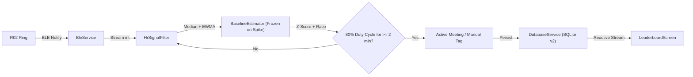

<div align="center">

# ⚡ Spike

### A premium Flutter companion app for the Colmi R02 BLE smart ring

**Real-time heart rate monitoring · Stress detection v2 algorithm · Coworker stress leaderboard**


---

*A sleek dark-mode interface that connects to your Colmi R02 smart ring,*
*streams live biometric data, detects stress spikes during meetings, and ranks your coworkers*
*by how much they raise your heart rate.* 😅

</div>

---

## ✨ Features

### 🫀 Real-Time Heart Rate Streaming
- Connects to the Colmi R02 via **Bluetooth Low Energy** using the proprietary Colmi UART protocol
- All-day continuous HR streaming with periodic 30-second keep-alive packets (`hrActionContinue`)
- Sliding-window CRC resynchronization and exponential backoff auto-reconnect
- Streams live BPM to the dashboard with a smooth gradient area chart

### 📊 Live Calm Score & Biometrics Dashboard
- Circular Calm Score ring driven in real time by your heart rate relative to your resting baseline
- Live metrics for Heart Rate, Calm Score, Baseline BPM, and daily Stress Spikes
- Frosted-glass bottom navigation bar with lazy-mounted tabs and smooth transitions

### 🔥 Stress Detection Algorithm v2
- **Signal conditioning (`HrSignalFilter`)**: Rejects physiological outliers (< 38 or > 210 BPM), enforces a 6 BPM/s slew-rate cap, and applies a 5-point median + EWMA filter
- **Spike-frozen baseline (`BaselineEstimator`)**: Tracks a 10-minute rolling **Median** and **Median Absolute Deviation (MAD)** and freezes updates while elevated so sustained spikes never self-contaminate your resting baseline
- **Z-score & ratio scoring (`StressScorer`)**: Combines individualized robust z-score ($z \ge 2.2$) and relative ratio ($\ge 1.22\times$ baseline and $+14\text{ BPM}$) into a continuous 0–100 Stress & Calm Score
- **Hysteresis state machine (`StressDetector`)**: Requires $\ge 2$ minutes with an **80% elevated duty cycle** (tolerating brief 1-sample dips) and enforces a 10-minute post-episode cooldown

### 🏆 Coworker Stress Leaderboard v2
- **Live Meeting Session Tracker**: Start an active meeting session with tagged coworkers so any stress spike during the meeting is automatically attributed
- **Manual Spike Tagging**: Retroactively tag untagged stress spikes or log manual spikes with saved coworker quick-chips
- **Time Window Filters**: Switch between **7 Days**, **30 Days**, and **All Time** rankings
- **Office-Safe Privacy Mode**: One-tap eye toggle masks coworker names to initials (`A.S.`) when sharing your screen
- **Coworker Detail Sheet**: Tap any ranked coworker or podium spot to inspect their spike count, peak/average HR, average elevation (`+Δ BPM`), and meeting history

---

## 🎨 Design

Spike follows a **premium dark-mode design language** with a deep palette and pastel accents:

| Role | Color | Hex |
|---|---|---|
| 🟦 Background | Deep Black | `#0A0A0F` |
| 🟩 Primary Accent | Pastel Teal | `#5ECFCA` |
| 🟥 Heart Rate | Pastel Coral | `#E8857A` |
| 🟨 Warning/Scanning | Pastel Amber | `#F0C75E` |
| 🟪 Accents | Pastel Lavender | `#B4A7D6` |
| 🌿 Connected/Success | Pastel Sage | `#8FBF9F` |

---

## 🏗️ Architecture

```
┌─────────────────────────────────────────────────────────┐
│                      Presentation                       │
│  HomeScreen · VitalsScreen · SleepScreen · Leaderboard  │
│  HeartRateCard · CalmRing · MetricCard                  │
├─────────────────────────────────────────────────────────┤
│                    State Management                     │
│      Riverpod Providers (ble · stress · vitals)         │
├─────────────────────────────────────────────────────────┤
│                      Services                           │
│  BleService · StressAnalyzerService · StressDetector    │
│  DatabaseService · ColmiProtocol · CalendarService      │
├─────────────────────────────────────────────────────────┤
│                      Platform                           │
│           flutter_blue_plus · sqflite                   │
└─────────────────────────────────────────────────────────┘
```

### Stress Detection v2 Flow



---

## 📁 Project Structure

```
lib/
├── main.dart                                # App entry, ProviderScope, lazy-mounted MainShell
├── models/
│   ├── stress_event.dart                    # StressEvent v2 model + SQLite serialization
│   └── leaderboard_entry.dart               # Aggregated coworker ranking entry + period filter
├── providers/
│   ├── ble_providers.dart                   # BLE connection, HR stream, auto-scan
│   ├── stress_providers.dart                # Stress analyzer, live telemetry, DB, leaderboard
│   └── vitals_provider.dart                 # Real-time HR history & session stats
├── screens/
│   ├── home_screen.dart                     # Calm score dashboard with live ring + metrics
│   ├── vitals_screen.dart                   # Real-time BLE heart rate & stress telemetry
│   ├── vital_details_screen.dart            # Detailed heart rate trend chart & stats
│   ├── sleep_screen.dart                    # Sleep tracking view
│   ├── activity_screen.dart                 # Activity tracking view
│   ├── leaderboard_screen.dart              # Coworker stress leaderboard v2 & tagging UI
│   └── settings_screen.dart                 # BLE device manager & data reset controls
├── services/
│   ├── ble_service.dart                     # BLE scan, connect, keep-alive, backoff reconnect
│   ├── colmi_protocol.dart                  # Colmi R02 packet encoder/decoder + CRC resync
│   ├── calendar_service.dart                # Manual meeting session context holder
│   ├── database_service.dart                # SQLite v2 schema, normalized junction & directory
│   ├── stress_analyzer_service.dart         # Coordinates v2 detector, meeting context, and DB
│   └── stress/
│       ├── hr_signal_filter.dart            # Outlier gate, slew-rate limiter, median + EWMA
│       ├── baseline_estimator.dart          # Rolling 10-min Median + MAD (frozen on spikes)
│       ├── stress_scorer.dart               # Z-score + relative elevation & Calm Score
│       └── stress_detector.dart             # Hysteresis state machine & 80% duty-cycle check
├── theme/
│   ├── app_colors.dart                      # Spike dark palette + pastel accents
│   └── app_theme.dart                       # Material theme configuration
├── utils/
│   ├── app_logger.dart                      # Centralized structured debug logger
│   ├── app_routes.dart                      # Shared slide-fade route transitions
│   └── date_formatter.dart                  # Date and relative timestamp formatters
└── widgets/
    ├── bottom_nav_bar.dart                  # Frosted-glass bottom navigation
    ├── heart_rate_card.dart                 # Isolated live HR chart card
    ├── metric_card.dart                     # Reusable metric display card
    └── readiness_ring.dart                  # Custom-painted circular calm score ring
```

---

## 🔌 Colmi R02 BLE Protocol

Spike implements the **reverse-engineered Colmi UART-over-BLE protocol** (not standard Bluetooth SIG):

| Item | Value |
|---|---|
| Service UUID | `6e40fff0-b5a3-f393-e0a9-e50e24dcca9e` |
| Write Characteristic | `6e400002-b5a3-f393-e0a9-e50e24dcca9e` |
| Notify Characteristic | `6e400003-b5a3-f393-e0a9-e50e24dcca9e` |
| Packet Size | Fixed 16 bytes |
| CRC | `sum(bytes[0..14]) & 0xFF` |

### Real-Time Heart Rate

```
Start:    Cmd 0x69 [Type=0x01 (HR), Action=0x01 (Start)]
Continue: Cmd 0x69 [Type=0x01 (HR), Action=0x02 (Continue / Keep-Alive every 30s)]
Stop:     Cmd 0x69 [Type=0x01 (HR), Action=0x00 (Stop)]
Receive:  Cmd 0x69 [byte[1]=0x01, byte[2]=errorCode, byte[3]=BPM]
```

> Protocol documentation: [colmi.puxtril.com](https://colmi.puxtril.com/commands/)

---

## 🛡️ Security & Permissions

### Android

| Permission | Purpose |
|---|---|
| `BLUETOOTH_SCAN` | Discover nearby R02 ring (`neverForLocation` on Android 12+) |
| `BLUETOOTH_CONNECT` | Establish BLE connection |
| `ACCESS_FINE_LOCATION` | Required for BLE scanning on Android 6–11 (`maxSdkVersion="30"`) |
| `FOREGROUND_SERVICE` | Keep BLE alive in background (API 34+) |
| `FOREGROUND_SERVICE_CONNECTED_DEVICE` | Android 14/15 BLE background service type |

### iOS

| Key | Purpose |
|---|---|
| `NSBluetoothAlwaysUsageDescription` | BLE ring connection & background streaming |
| `UIBackgroundModes: bluetooth-central` | Keep BLE notifications active in background |

---

## 🚀 Getting Started

### Prerequisites

- Flutter SDK ≥ 3.7.0
- Xcode 15+ (for iOS)
- Android Studio / SDK (minSdk 21)
- A **Colmi R02** smart ring (for BLE features)

### Installation

```bash
# Clone the repository
git clone https://github.com/Sujaya-Nimneth/SPIKE.git
cd SPIKE

# Install dependencies
flutter pub get

# Run on a connected device (BLE requires a physical device)
flutter run
```

> **Note**: BLE scanning does not work on emulators/simulators. You need a physical device with Bluetooth LE support.

### Verify

```bash
# Static analysis
flutter analyze

# Run unit and widget tests
flutter test
```

---

## 📦 Dependencies

| Package | Version | Purpose |
|---|---|---|
| [`flutter_blue_plus`](https://pub.dev/packages/flutter_blue_plus) | ^1.35.2 | Bluetooth Low Energy communication |
| [`flutter_riverpod`](https://pub.dev/packages/flutter_riverpod) | ^2.6.1 | Reactive state management |
| [`fl_chart`](https://pub.dev/packages/fl_chart) | ^0.70.2 | Heart rate area chart visualization |
| [`sqflite`](https://pub.dev/packages/sqflite) | ^2.4.2 | Local SQLite database for stress events & leaderboard |
| [`google_fonts`](https://pub.dev/packages/google_fonts) | ^6.2.1 | Inter font family for typography |

---

## 🗄️ Database Schema (v2)

```sql
CREATE TABLE stress_events (
    id                 INTEGER PRIMARY KEY AUTOINCREMENT,
    timestamp          TEXT NOT NULL,
    peak_hr            INTEGER NOT NULL,
    avg_hr             REAL NOT NULL DEFAULT 0,
    baseline_hr        INTEGER NOT NULL,
    baseline_mad       REAL NOT NULL DEFAULT 3.0,
    stress_score       REAL NOT NULL DEFAULT 60.0,
    z_score            REAL NOT NULL DEFAULT 2.2,
    area_over_baseline REAL NOT NULL DEFAULT 0.0,
    meeting_title      TEXT,
    attendees          TEXT,
    duration_seconds   INTEGER NOT NULL,
    source             TEXT NOT NULL DEFAULT 'auto'
);

CREATE TABLE stress_event_attendees (
    id                INTEGER PRIMARY KEY AUTOINCREMENT,
    event_id          INTEGER NOT NULL,
    coworker_name     TEXT NOT NULL,
    normalized_name   TEXT NOT NULL,
    elevated_delta_hr REAL NOT NULL DEFAULT 0,
    stress_score      REAL NOT NULL DEFAULT 60.0
);

CREATE TABLE coworker_directory (
    id              INTEGER PRIMARY KEY AUTOINCREMENT,
    display_name    TEXT NOT NULL,
    normalized_name TEXT NOT NULL UNIQUE,
    created_at      TEXT NOT NULL
);
```

---

## 📄 License

This project is licensed under the MIT License — see the [LICENSE](LICENSE) file for details.

---

<div align="center">

**Built with ⚡ by Spike**

*Because the real heart rate monitor is the meetings we survived along the way.*

</div>
